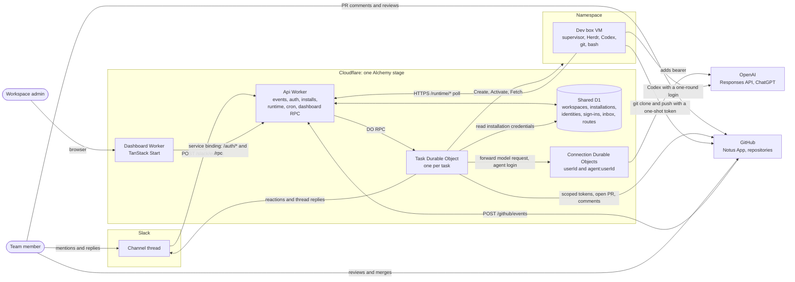
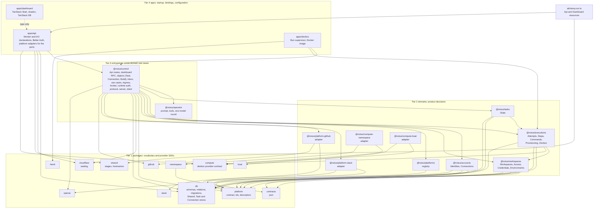
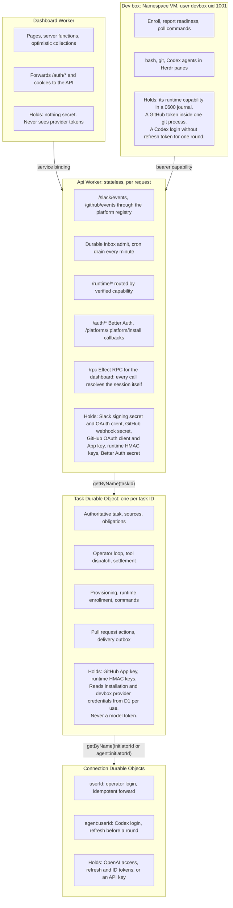

# System design

The built system at a glance: its primitives, who talks to whom, the code tiers, and where each credential lives. [Architecture rules](CONTEXT.md) own the conventions.

## Primitives

| Primitive          | What it is                                                                                                                           | Where it lives                                          |
| ------------------ | ------------------------------------------------------------------------------------------------------------------------------------ | ------------------------------------------------------- |
| Stage              | One deployment: a developer's own (`$USER`) or `production`, each with its own Workers, databases, objects and `notus.run` hostnames | Alchemy stack                                           |
| Workspace          | A team's configuration and access boundary: members with roles, installations, scopes, dev box environment                           | Shared D1                                               |
| Platform           | A system humans talk through: `slack` or `github`. One adapter per platform implements the `@notus/platform` contract                | Code: `@notus/platform-slack`, `@notus/platform-github` |
| Installation       | A platform connected to one workspace: a Slack team with its bot token, a GitHub App installation                                    | D1 `workspace_installations`                            |
| Scope              | A place the workspace covers inside an installation: a channel, a repository                                                         | D1 `workspace_scopes`                                   |
| Source             | A conversation address: `platform, installationId, scope, conversation` (a thread, a pull request number)                            | Inputs, routes, task sources                            |
| Input              | One verified, platform-neutral message with an actor, reply target, start intent and `root` flag                                     | D1 inbox, then the Task object                          |
| Route              | Binds one conversation to one task ID and its initiator. A task owns its origin thread and any attached pull request                 | D1 `inbox_routes`                                       |
| Task               | The authoritative record of one piece of work: origin and attached sources, inputs, answer obligations, responses                    | One Task Durable Object per task ID                     |
| Attempt            | One assignment of the task to an execution mode (`simulation`, `readiness`, `operator`); one active per task                         | Task object                                             |
| Invocation         | One operator turn, created for exactly one admitted human input                                                                      | Task object                                             |
| Step               | One persisted model round inside a turn; may end in text or in unresolved tool calls                                                 | Task object                                             |
| Command            | Durable work a tool call needs: `shell`, `checkout`, `push`, `specialist` run on the box; `pull-request` runs in control             | Task object                                             |
| Provisioning state | The dev box's lifecycle: phase, provider resource, runtime epoch, readiness                                                          | Task object                                             |
| Capability         | An HMAC-signed bearer token (`nr1.`) naming the task binding it authorizes: Enrollment or Readiness                                  | Issued by the Task object's host, held by the box       |
| Delivery           | An outbox row for one reaction or answer, sent through the platform registry, with its own claim and outcome                         | Task object                                             |
| Connection         | One saved model login. `userId` serves the operator; `agent:userId` serves Codex on the box                                          | One Connection Durable Object per name                  |
| Canonical user     | The Notus user a Slack mention or dashboard sign-in resolves to; Better Auth users map onto it through `account_logins`              | Shared D1, plus Better Auth tables in `AuthDb`          |
| Operation ID       | The idempotency key of an external effect: a model forward, a provisioning create                                                    | Step, provisioning state                                |
| Gate               | `blockConcurrencyWhile`: short, local, synchronous-SQLite critical sections. Network work never runs inside it                       | Task and Connection objects                             |
| Claim / lease      | Take work under a gate with an expiry, do it outside, record it only if the claim still matches                                      | Everywhere                                              |

## System context

Who talks to whom. Every arrow is a real network call. Hostnames are per stage: `<stage>.notus.run` for the dashboard and `api.<stage>.notus.run` for the API, or `notus.run` and `api.notus.run` in production.

The dev box and the dashboard never accept inbound connections from Notus. The box dials the Worker, and the Worker routes each call to the Task object named inside the signed capability. The dashboard reaches the API only through its service binding.

## Code tiers

Imports only point downward or sideways. Arrows are the main `@notus/*` imports in `src/`.

`@notus/platform` depends on `effect` only, so descriptors can be imported anywhere. `@notus/slack` and `@notus/github` know nothing about Notus. Only the two adapter domains import them for sources, and entrypoints only see `@notus/platforms`. The dashboard imports the RPC contract, `@notus/control/dashboard/rpcs`, which holds schemas only.

## Hosts, responsibilities and secrets

Five runtime hosts. The main design constraint is where each credential can and cannot exist.

