# System design

How Notus works as built at commit `4cd36b9` (2026-09-15), from the system context down to the wire between the dev box and its Task object. [Architecture rules](CONTEXT.md) own conventions, the [codebase proposal](../plans/codebase.md) owns ownership, and the slice plans own each increment's scope and validation: [operator](../plans/operator.md), [repository](../plans/repository.md), [platforms](../plans/platforms.md), [dashboard](../plans/dashboard.md).

## Contents

1. [Primitives](#primitives)
2. [System context](#1-system-context)
3. [Code tiers](#2-code-tiers)
4. [Hosts, responsibilities and secrets](#3-hosts-responsibilities-and-secrets)
5. [The platform seam](#4-the-platform-seam)
6. [One task end to end](#5-one-task-end-to-end)
7. [Intake: any platform to the Task object](#6-intake-any-platform-to-the-task-object)
8. [Inside the Task object: the alarm pass](#7-inside-the-task-object-the-alarm-pass)
9. [Operator turns, steps and the model broker](#8-operator-turns-steps-and-the-model-broker)
10. [Tool calls become durable work](#9-tool-calls-become-durable-work)
11. [Dev box provisioning](#10-dev-box-provisioning)
12. [Dev box and Task object: enrollment, readiness, commands](#11-dev-box-and-task-object-enrollment-readiness-commands)
13. [Specialist rounds](#12-specialist-rounds)
14. [Repository access and pull requests](#13-repository-access-and-pull-requests)
15. [Pull request feedback continues the task](#14-pull-request-feedback-continues-the-task)
16. [Answers back to the platform: the delivery outbox](#15-answers-back-to-the-platform-the-delivery-outbox)
17. [Dashboard: sign-in, workspaces and installs](#16-dashboard-sign-in-workspaces-and-installs)
18. [Claims, leases and fences](#17-claims-leases-and-fences)
19. [Storage map](#18-storage-map)
20. [Not built yet](#19-not-built-yet)

## Primitives

| Primitive          | What it is                                                                                                                           | Where it lives                                             |
| ------------------ | ------------------------------------------------------------------------------------------------------------------------------------ | ---------------------------------------------------------- |
| Stage              | One deployment: a developer's own (`$USER`) or `production`, each with its own Workers, databases, objects and `notus.run` hostnames | Alchemy stack                                              |
| Workspace          | A team's configuration and access boundary: members with roles, installations, scopes, dev box environment                           | Shared D1                                                  |
| Platform           | A system humans talk through: `slack` or `github`. One adapter per platform implements the `@notus/platform` contract                | Code: `@notus/platform-slack`, `@notus/platform-github`    |
| Installation       | A platform connected to one workspace: a Slack team with its bot token, a GitHub App installation                                    | D1 `workspace_installations`                               |
| Scope              | A place the workspace covers inside an installation: a channel, a repository                                                         | D1 `workspace_scopes`                                      |
| Source             | A conversation address: `platform, installationId, scope, conversation` (a thread, a pull request number)                            | Inputs, routes, task sources                               |
| Input              | One verified, platform-neutral message with an actor, reply target, start intent and `root` flag                                     | D1 inbox, then the Task object                             |
| Route              | Binds one conversation to one task ID and its initiator. A task owns its origin thread and any attached pull request                 | D1 `inbox_routes`                                          |
| Task               | The authoritative record of one piece of work: origin and attached sources, inputs, answer obligations, responses                    | One Task Durable Object per task ID                        |
| Attempt            | One assignment of the task to an execution mode (`simulation`, `readiness`, `operator`); one active per task                         | Task object                                                |
| Invocation         | One operator turn, created for exactly one admitted human input                                                                      | Task object                                                |
| Step               | One persisted model round inside a turn; may end in text or in unresolved tool calls                                                 | Task object                                                |
| Command            | Durable work a tool call needs: `shell`, `checkout`, `push`, `specialist` run on the box; `pull-request` runs in control             | Task object                                                |
| Provisioning state | The dev box's lifecycle: phase, provider resource, runtime epoch, readiness                                                          | Task object                                                |
| Capability         | An HMAC-signed bearer token (`nr1.`) naming the task binding it authorizes: Enrollment or Readiness                                  | Issued by the Task object's host, held by the box          |
| Delivery           | An outbox row for one reaction or answer, sent through the platform registry, with its own claim and outcome                         | Task object                                                |
| Connection         | One saved model login. `userId` serves the operator; `agent:userId` serves Codex on the box                                          | One Connection Durable Object per name                     |
| Canonical user     | The Notus user a Slack mention or dashboard sign-in resolves to; Better Auth users map onto it through `account_logins`              | Shared D1, plus Better Auth tables in `AuthDb`             |
| Operation ID       | The idempotency key of an external effect: a model forward, a provisioning create                                                    | Step, provisioning state                                   |
| Gate               | `blockConcurrencyWhile`: short, local, synchronous-SQLite critical sections. Network work never runs inside it                       | Task and Connection objects                                |
| Claim / lease      | Take work under a gate with an expiry, do it outside, record it only if the claim still matches                                      | Everywhere, see [section 17](#17-claims-leases-and-fences) |

## 1. System context

Who talks to whom. Every arrow is a real network call. Hostnames are per stage: `<stage>.notus.run` for the dashboard and `api.<stage>.notus.run` for the API, or `notus.run` and `api.notus.run` in production.

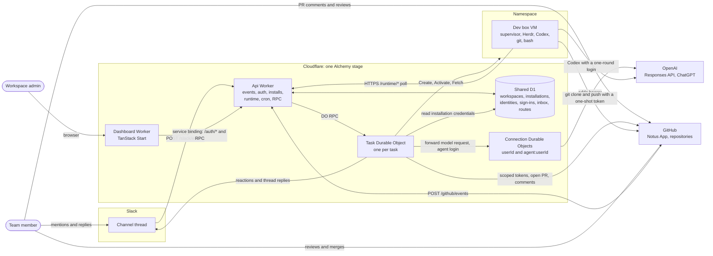

The dev box and the dashboard never accept inbound connections from Notus. The box dials the Worker, and the Worker routes each call to the Task object named inside the signed capability. The dashboard reaches the API only through its service binding.

## 2. Code tiers

Imports only point downward or sideways. Arrows are real `@notus/*` imports in `src/`.

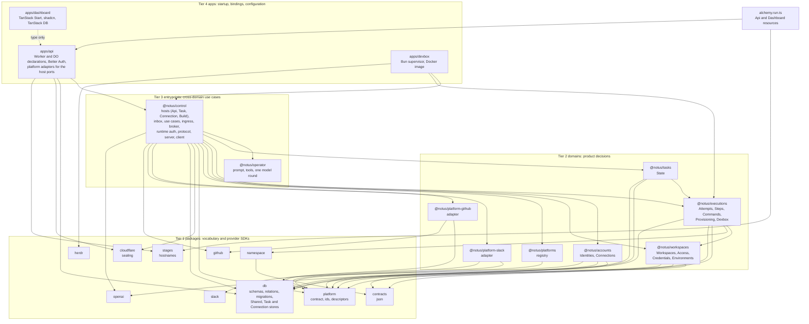

`@notus/platform` depends on `effect` only, so descriptors can be imported anywhere. `@notus/slack` and `@notus/github` know nothing about Notus. Only the two adapter domains import them for sources, and entrypoints only see `@notus/platforms`. The dashboard imports the API's type for its RPC client, never its code.

## 3. Hosts, responsibilities and secrets

Five runtime hosts. The main design constraint is where each credential can and cannot exist.

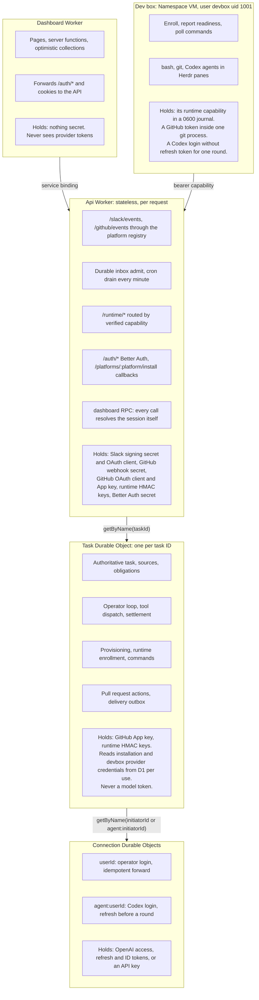

## 4. The platform seam

Core code never branches on `slack` or `github`. The Worker and the Task object each build one registry from the deployed adapters. Everything platform-specific happens behind it: verifying and normalizing webhooks, installing, listing scopes, deciding who may participate, and resolving reply handles.

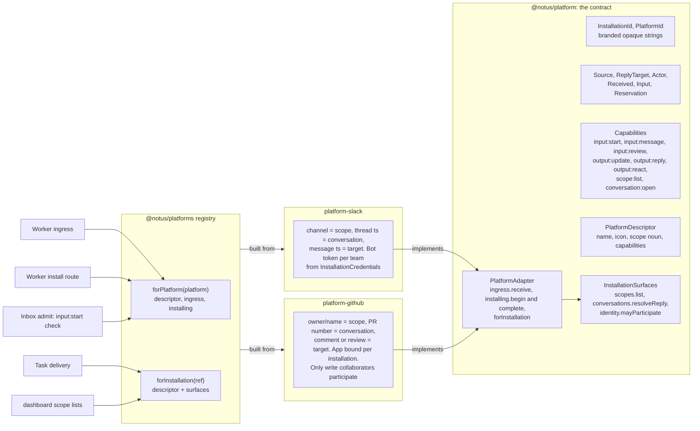

| Capability          | Slack | GitHub | Meaning in practice                                              |
| ------------------- | ----- | ------ | ---------------------------------------------------------------- |
| `input:start`       | yes   | no     | Only a Slack mention can start a task                            |
| `input:message`     | yes   | yes    | Replies in an attached conversation are inputs                   |
| `input:review`      | no    | yes    | Review comments and reviews are inputs                           |
| `output:update`     | yes   | no     | Progress goes to the Slack origin thread only                    |
| `output:reply`      | yes   | yes    | Answers land on the input's own target                           |
| `output:react`      | yes   | yes    | Eyes reaction as receipt; GitHub reviews themselves cannot react |
| `scope:list`        | yes   | yes    | The dashboard picker lists channels or repositories              |
| `conversation:open` | no    | yes    | Notus opens pull requests                                        |

## 5. One task end to end

The live path: a Slack mention, a specialist round, a pull request, a review comment on GitHub and the follow-up. Later sections open each box.

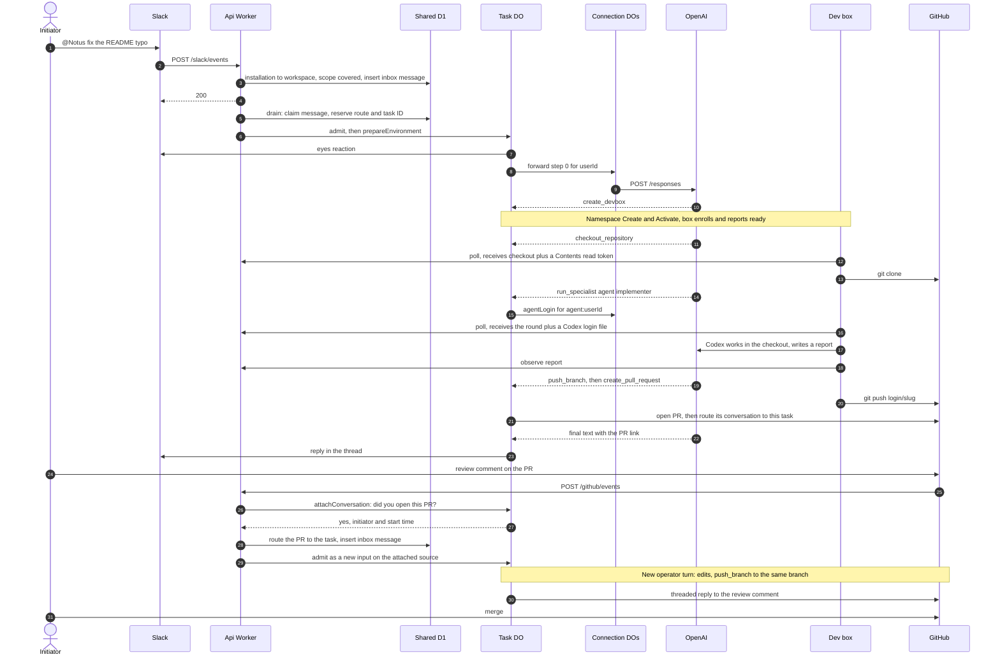

## 6. Intake: any platform to the Task object

Intake is two-phase on purpose. The webhook request only commits a durable inbox row, so the platform gets its acknowledgement fast. A separate drain, started with `waitUntil` right away and repeated by cron every minute, moves rows into Task objects. One route, `/<platform>/events`, serves every platform (`entrypoints/control/src/ingress.ts`).

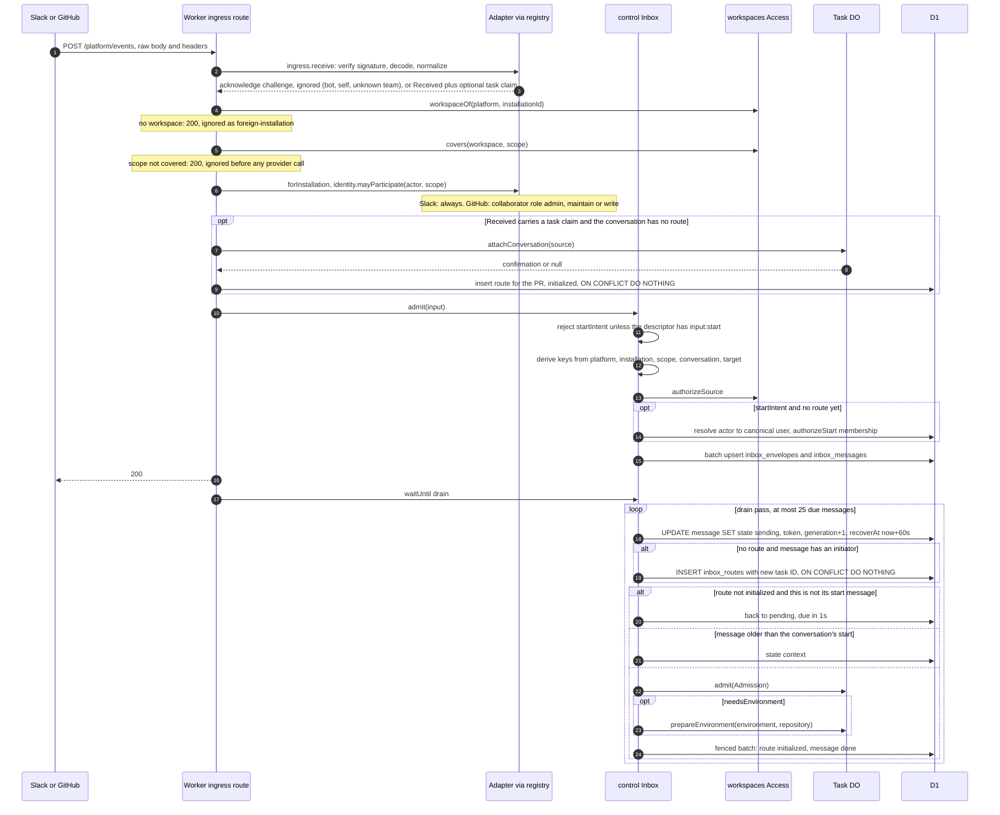

The route decides task identity. A Slack start mention creates the route, and every later message in that thread goes to the same task ID. A pull request gets its route only when the task confirms it opened that PR. Messages from before a conversation's start timestamp are kept as context only.

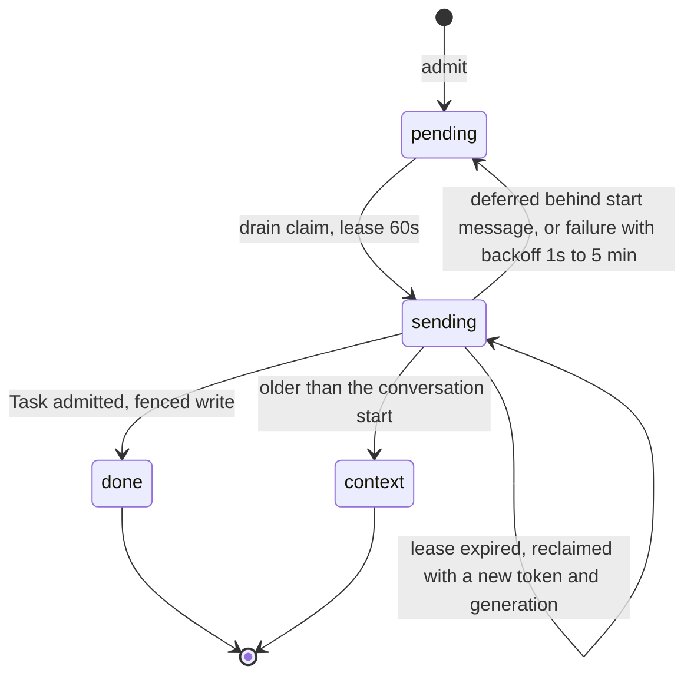

## 7. Inside the Task object: the alarm pass

The Task object is a durable scheduler, not a request handler. Every entry point writes intent under the gate, arms an alarm, and returns. The alarm does the work in bounded batches. Network calls always happen between two gates: claim inside, call outside, record inside.

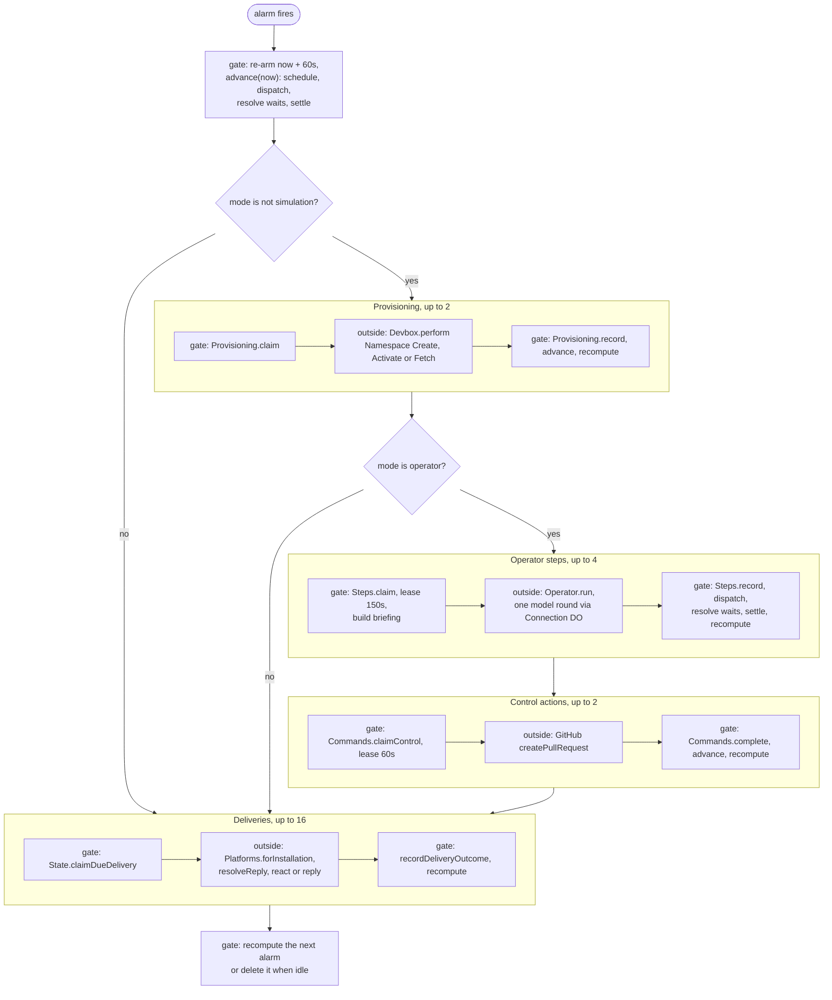

Entry points that are not the alarm:

| Method               | Called by                  | Gate work                                                        | Outside the gate                                        |
| -------------------- | -------------------------- | ---------------------------------------------------------------- | ------------------------------------------------------- |
| `admit`              | Inbox drain                | Record input on its origin or attached source, schedule the turn | None                                                    |
| `prepareEnvironment` | Inbox drain                | Capture environment and repository once                          | None                                                    |
| `attachConversation` | Ingress route              | Confirm a completed PR action for this exact source, attach it   | None                                                    |
| `runtimeAssignment`  | Box, Enrollment capability | Read the assigned resource and instance                          | None                                                    |
| `runtimeEnroll`      | Box, Enrollment capability | Replay check, then commit the epoch grant                        | Namespace Fetch to verify the instance, signing replies |
| `runtimeReady`       | Box, Readiness capability  | Accept readiness, advance                                        | Namespace Fetch                                         |
| `runtimePoll`        | Box, Readiness capability  | One command claim per second, up to `waitMs`                     | Mint a GitHub token, or fetch a Codex login for a round |
| `runtimeObserve`     | Box, Readiness capability  | Record the result under the epoch, advance                       | None                                                    |
| `snapshot`           | Binding RPC only           | Read everything except secrets                                   | None                                                    |

## 8. Operator turns, steps and the model broker

### Data model of a turn

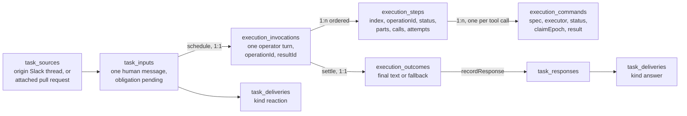

### Step lifecycle

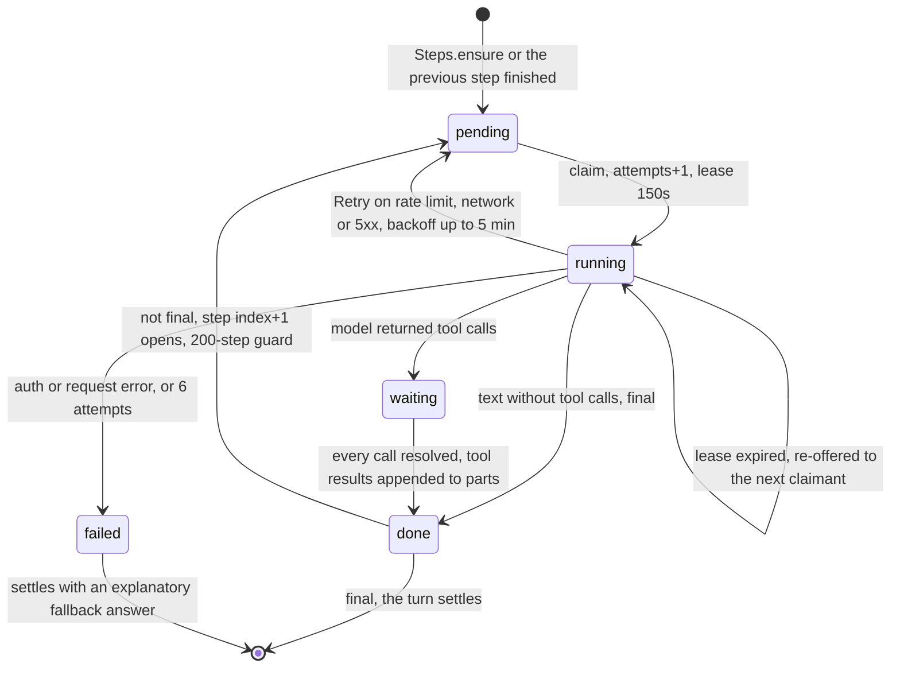

Each claim replays the whole turn: the briefing plus the encoded response parts of every earlier step, including tool results. The briefing holds the system prompt with task, dev box and repository state, the conversation history, and the current message. Every human message in the briefing is labeled with where it arrived, a Slack message or a GitHub pull request comment. The operator knows its answer to a PR comment is posted on GitHub. Nothing is stored on OpenAI's side: `store: false` is set, and encrypted reasoning travels inside the prompt.

### One model round through the broker

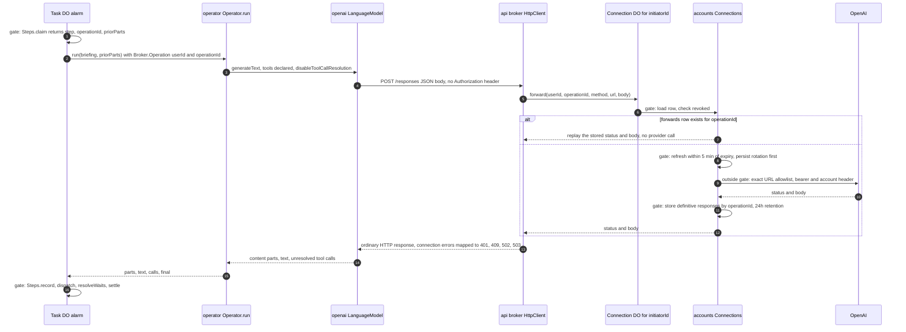

The same `operationId` is reused when a lost isolate re-runs a claimed step, so a completed provider call is not paid for twice.

## 9. Tool calls become durable work

The model never runs a tool inline; the toolkit handlers deliberately die. `dispatch` turns each call of a waiting step into durable state. `evaluate` reads that state on every pass until the call resolves.

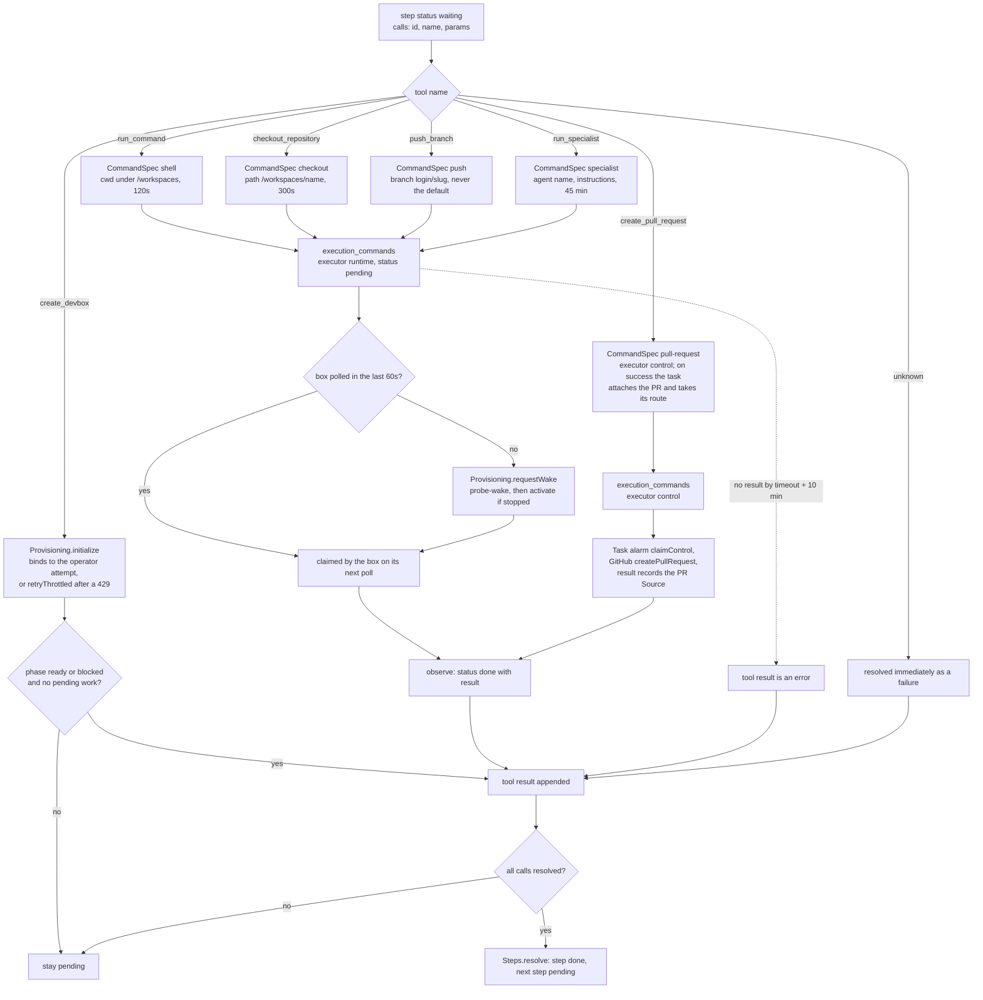

| Tool                  | Result the model reads                   | Notes                                                                                     |
| --------------------- | ---------------------------------------- | ----------------------------------------------------------------------------------------- |
| `create_devbox`       | phase, ready, resource, message          | A throttled Create blocks as `provider-throttled`; a later call re-arms the same creation |
| `run_command`         | exit code, truncated stdout and stderr   | No credentials in the environment                                                         |
| `checkout_repository` | path, branch, head SHA                   | Repeated calls report the existing checkout                                               |
| `run_specialist`      | report, or error with the agent's screen | Same agent name reuses the same Codex agent and its memory                                |
| `push_branch`         | branch, head SHA, `newCommit`            | `newCommit` is false when this branch already had that commit                             |
| `create_pull_request` | number, URL, branch                      | Opened by control, never on the box                                                       |

## 10. Dev box provisioning

A task gets at most one attempt and one box. The machine separates work that is claimed from work whose outcome is uncertain. An ambiguous Create or Activate is reconciled, never blindly repeated.

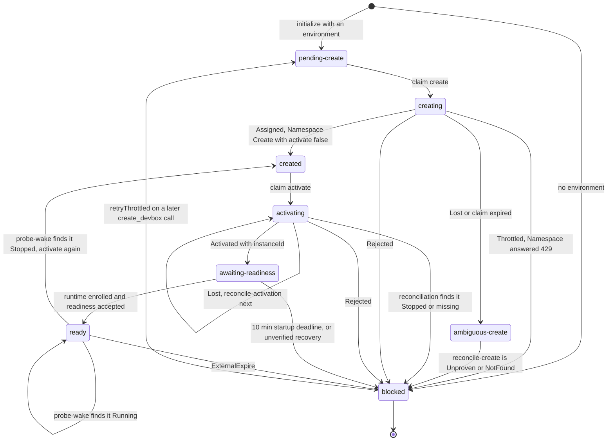

`Devbox.perform` is the only place provisioning talks to Namespace. For `create` it issues the Enrollment capability and passes it with the control URL as box environment variables. The box session command is fixed as `exec /usr/local/bin/notus-devbox start`, and the image must be the approved, audited reference. Only a `provider-throttled` block with no resource can be re-armed, because nothing was created.

## 11. Dev box and Task object: enrollment, readiness, commands

The lowest-level connection in the system. The box never listens on a port. Every call is an HTTPS POST from the supervisor to the Worker's `/runtime/*` routes with a bearer capability.

### Capabilities

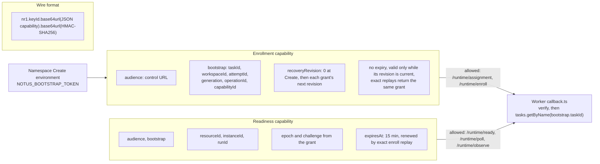

The request body never selects a task: routing and authority come only from the verified capability. The Worker rejects a Readiness token on enrollment routes and an Enrollment token on runtime routes with 403.

### The full conversation

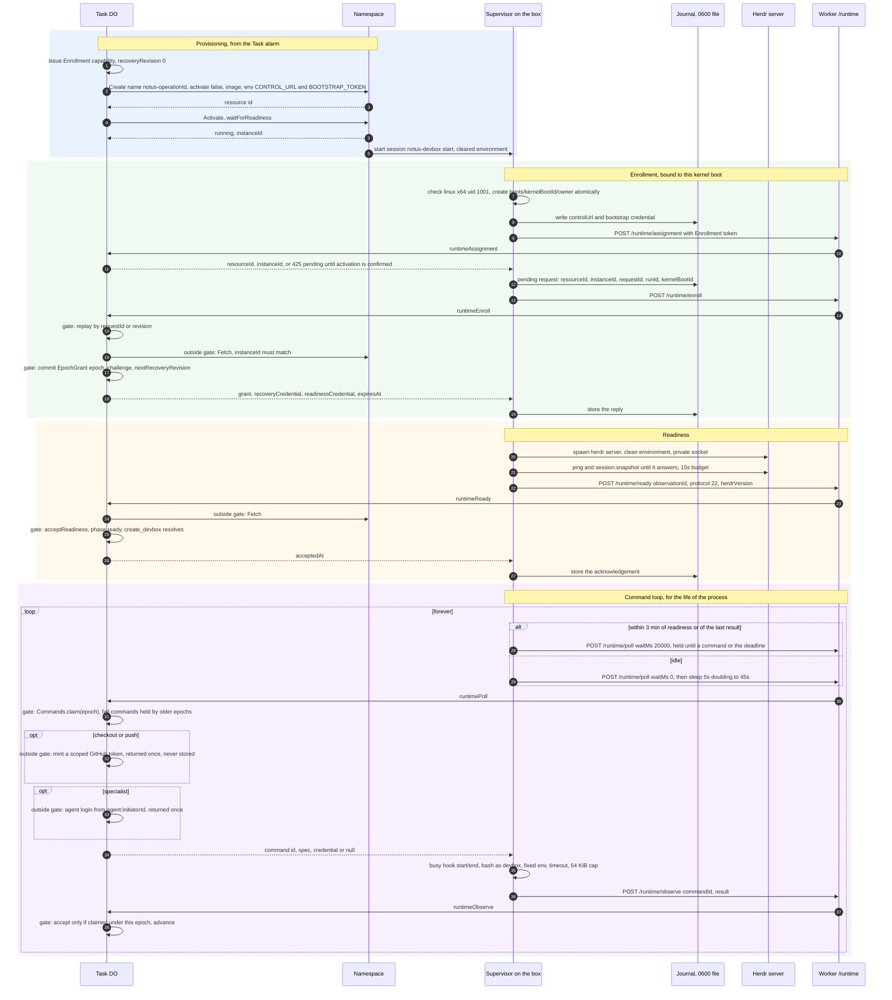

A held poll keeps the Task object busy, so an idle box stops long-polling. The idle cap of 45 seconds stays under control's 60-second staleness threshold, so a queued command reaches a running box without a provider wake. While a command runs, a marker file under `/.namespace/tasks` stops Namespace from stopping the box as idle.

### Recovery rules

- The journal is the box's only durable authority. It is written atomically (temp file, fsync, rename) and bound to the control URL.
- A pending enrollment from the same kernel boot ID means an unknown earlier process may still be running, so the supervisor refuses to start. After a reboot it first recovers the earlier reply by exact replay, then enrolls again with the next recovery credential.
- A re-enrollment after a new VM boot must prove the previous instance was destroyed through the Namespace instances API. Otherwise provisioning blocks with `recovery-unverified`.
- A poll from a newer epoch fails every command the old runtime had claimed (`runtime-restarted`), and nothing reruns automatically. A late observe from the old epoch is rejected with `conflict`.
- A Readiness token close to expiry is renewed by replaying the exact enrollment request. The same grant comes back with a fresh token, and the supervisor never invents an epoch.

### Command lifecycle

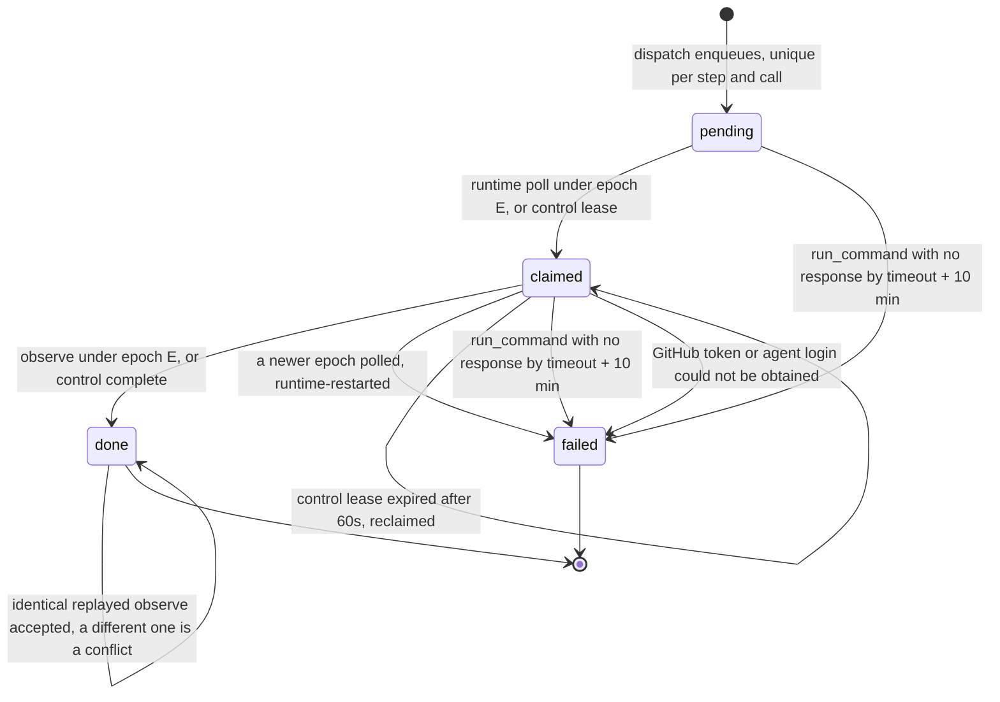

## 12. Specialist rounds

`run_specialist` hands one round of work to a named Codex agent running in a Herdr pane on the box. It is an ordinary runtime command with a 45-minute budget. Its credential is special: it's a login from the initiator's agent connection, not a GitHub token.

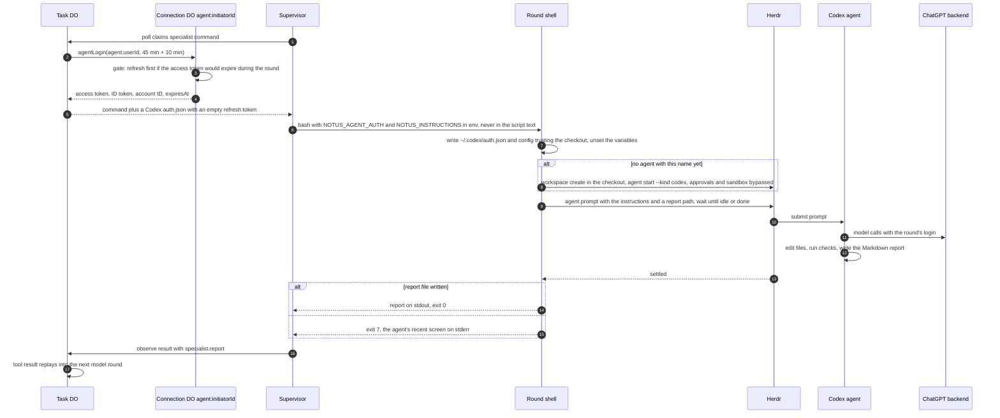

The instructions the agent reads are composed by control, not written whole by the operator: the workspace's role the call names (`# Role: implementer`: its summary, then its instructions), then the operator's instructions for the round (`# This round`). The role text comes from the roles the task captured when it started, so an edit on the dashboard's Specialists page reaches new tasks only. A role the workspace never defined fails the call with the list of roles, and no command is queued.

The agent can edit files but cannot publish; `push_branch` is still the only way code leaves the box. The box never receives a refresh token, the operator's model connection, or an API key.

## 13. Repository access and pull requests

One GitHub App, used through a bound installation. Every operation mints its own installation token, scoped to one repository with the least permissions it needs. No token ever combines Contents write with Pull requests write, which the merge endpoint requires, so no Notus credential can merge.

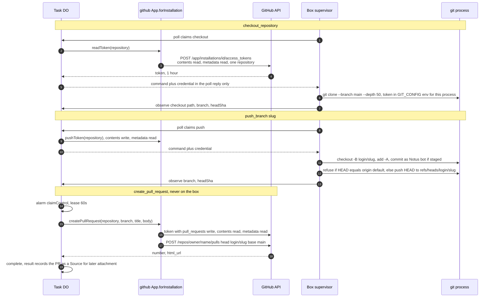

| Operation             | Runs where           | Token permissions                                 | Can it merge?                                        |
| --------------------- | -------------------- | ------------------------------------------------- | ---------------------------------------------------- |
| Checkout              | Box, one git process | Contents read, Metadata read                      | No                                                   |
| Push                  | Box, one git process | Contents write, Metadata read                     | No, and the refspec never targets the default branch |
| Open PR               | Task object          | Pull requests write, Contents read, Metadata read | No                                                   |
| Comment, reply, react | Task object delivery | Pull requests write, Contents read                | No                                                   |
| Collaborator role     | Api Worker ingress   | Metadata read                                     | No                                                   |
| `run_command`, Codex  | Box                  | None                                              | No; `git push` from bash cannot authenticate         |

## 14. Pull request feedback continues the task

A pull request comment never starts a task. It continues the task that owns the PR conversation: the task that opened it or, since 2026-09-16, the last task that checked it out by number. That task attached the conversation and wrote the inbox route itself when the action completed; the ingress only looks the route up.

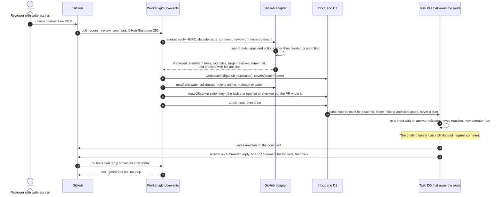

Rules this enforces:

- The Slack origin thread remains the only update channel.
- Feedback never changes the task's owner or the model connection it uses.
- Nothing in a webhook payload can route feedback: only a task that opened or checked out the pull request writes its route.

Known limits:

- GitHub does not retry failed deliveries.
- A comment in the instant between opening the PR and recording the result is not attached.
- Comments from non-writers are dropped, not kept as review context.

## 15. Answers back to the platform: the delivery outbox

Every admitted human input creates an answer obligation and an eyes reaction delivery in the same transaction. A settled turn creates the response and its answer delivery together. The delivery resolves a handle through `Platforms.forInstallation(target.source)`, so the same outbox serves Slack threads and GitHub comments.

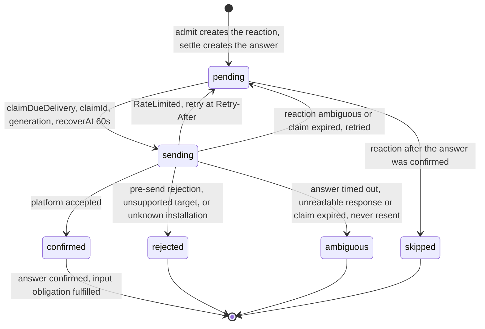

An answer whose send may have succeeded is never retried automatically, so a conversation gets no duplicate replies. The obligation stays open instead of being reported as delivered. A GitHub review cannot carry a reaction, so its reaction delivery is rejected while its answer still goes out.

## 16. Dashboard: sign-in, workspaces and installs

The dashboard holds no data and no secrets. Every server function forwards the browser's cookie to an API RPC method. The API resolves the Better Auth session itself and authorizes against workspace membership and role.

```mermaid
sequenceDiagram
  autonumber
  actor A as Admin browser
  participant DW as Dashboard Worker
  participant W as Api Worker
  participant BA as Better Auth on the shared D1
  participant Id as accounts Identities
  participant WS as workspaces Workspaces
  participant P as Slack or GitHub

  rect rgb(235, 242, 255)
  Note over A,BA: Sign in with Slack or GitHub
  A->>DW: /auth/sign-in/...
  DW->>W: forward through the service binding
  W->>BA: OAuth or OpenID flow, session cookie on the dashboard origin
  end

  rect rgb(240, 250, 240)
  Note over A,WS: Any dashboard call
  A->>DW: page load or mutation
  DW->>W: RPC dashboardX(cookie, ...)
  W->>BA: getSession, listUserAccounts
  W->>Id: adopt: map the auth user to a canonical user,<br/>adopting an existing user that owns a verified identity
  W->>WS: authorize by membership and role, then act
  W-->>DW: ok with a projection, or a reason string
  end

  rect rgb(255, 248, 235)
  Note over A,P: Install a platform
  A->>DW: Install Slack or GitHub
  DW->>W: dashboardInstallUrl(cookie, workspace, platform)
  W->>WS: beginInstall: admin only, single-use nonce, 15 min
  W-->>A: platform URL with state = nonce
  A->>P: consent
  P->>W: GET /platforms/platform/install?state and code or installation_id
  W-->>A: 302 to the same path on the dashboard origin, for the session cookie
  A->>DW: GET /platforms/platform/install with the cookie
  DW->>W: dashboardCompleteInstall(cookie, platform, query)
  W->>WS: takeInstallIntent(nonce): only the user who began it completes it
  W->>P: adapter completes: Slack oauth.v2.access; GitHub App JWT lookup, then the installer's<br/>own user token must reach the installation with push on every repository it covers
  W->>WS: install: record installation and credential, refused if another workspace holds it
  W-->>A: 302 to the workspace Platforms page
  end
```

What a workspace controls from the dashboard:

| Area      | Stored in                                         | Who                           |
| --------- | ------------------------------------------------- | ----------------------------- |
| Workspace | `workspaces` name and slug                        | Admin                         |
| Members   | `workspace_memberships` with `admin` or `member`  | Admin                         |
| Invites   | `workspace_invites`, hashed token, 7 days         | Admin creates, anyone accepts |
| Platforms | `workspace_installations` with adapter credential | Admin                         |
| Scopes    | `workspace_scopes`, channels and repositories     | Admin, from the installation  |
| Sessions  | Better Auth sessions                              | The user                      |

## 17. Claims, leases and fences

The same pattern appears at every boundary where a network call meets durable state:

```mermaid
flowchart LR
  a["1. Claim inside a transaction or gate<br/>record owner token, generation or epoch,<br/>and a recoverAt deadline"] --> b["2. Do external work outside<br/>the gate, never inside<br/>a transaction"]
  b --> c["3. Record only if the stored claim<br/>still equals the one taken,<br/>otherwise a stale claim"]
  a -.->|"deadline passes"| d["Recovery: a later pass reclaims,<br/>or marks the work ambiguous<br/>when repeating is unsafe"]
  d --> a
```

| Claim             | Store                            | Fence                                                                 | Lease                   | On expiry                                                                      |
| ----------------- | -------------------------------- | --------------------------------------------------------------------- | ----------------------- | ------------------------------------------------------------------------------ |
| Inbox message     | D1 `inbox_messages`              | `token` + `generation` + `state = sending`                            | 60s                     | Reclaimed with a new token                                                     |
| Route reservation | D1 `inbox_routes`                | Primary key on conversation, `INSERT ... ON CONFLICT DO NOTHING`      | None                    | First writer wins, everyone reloads                                            |
| PR attachment     | Task `task_sources` and D1 route | Done pull-request command with an equal `Source`; route task ID check | None                    | Unconfirmed claims are dropped; a route owned by another task is a conflict    |
| Install intent    | D1 `workspace_install_intents`   | Nonce primary key, taken once                                         | 15 min                  | Callback lands on `?install=expired-intent`                                    |
| Provisioning work | Task `execution_provisioning`    | Exact `Claim` value equality, `claimGeneration`                       | 30s                     | `create` becomes `reconcile-create`, `activate` becomes `reconcile-activation` |
| Operator step     | Task `execution_steps`           | `attempts` + `recoverAt`                                              | 150s                    | Same step and same `operationId` re-offered                                    |
| Runtime command   | Task `execution_commands`        | `claimEpoch` equals the caller's grant epoch                          | Until timeout + 10 min  | Failed; a newer epoch fails it at once                                         |
| Control action    | Task `execution_commands`        | `claimedAt`                                                           | 60s                     | Re-offered to the next alarm                                                   |
| Delivery          | Task `task_deliveries`           | `claimId` + `generation` + `recoverAt`                                | 60s                     | Reaction retried, answer marked ambiguous                                      |
| Model forward     | Connection `account_forwards`    | `operationId` primary key                                             | 24h replay window       | Identical response replayed                                                    |
| Enrollment        | Task `execution_enrollments`     | `(attemptId, revision)` and `(attemptId, requestId)` unique           | Grant token 15 min      | Exact replay returns the same grant                                            |
| Readiness         | Task `execution_readiness`       | `(attemptId, epoch)` and `observationId` unique                       | Startup deadline 10 min | Blocked with `startup-timeout`                                                 |
| Box process       | Box `boots/kernelBootId/owner`   | Atomic `mkdir`                                                        | Process lifetime        | Refused after a same-boot crash                                                |

## 18. Storage map

Shared D1 holds workspace-scoped control data, written through ordinary Worker-hosted services.

```mermaid
erDiagram
  WORKSPACES ||--o{ WORKSPACE_MEMBERSHIPS : "members"
  WORKSPACES ||--o{ WORKSPACE_INVITES : "invites"
  WORKSPACES ||--o{ WORKSPACE_INSTALLATIONS : "installed platforms"
  WORKSPACE_INSTALLATIONS ||--o{ WORKSPACE_SCOPES : "covered scopes"
  WORKSPACES ||--o{ WORKSPACE_INSTALL_INTENTS : "pending installs"
  WORKSPACES ||--o| WORKSPACE_ENVIRONMENTS : "dev box config"
  WORKSPACES ||--o{ WORKSPACE_ENVIRONMENT_REVISIONS : "every save"
  ACCOUNT_USERS ||--o{ WORKSPACE_MEMBERSHIPS : "belongs"
  ACCOUNT_USERS ||--o{ ACCOUNT_IDENTITIES : "verified identities"
  ACCOUNT_USERS ||--o{ ACCOUNT_LOGINS : "dashboard sign-ins"
  INBOX_ENVELOPES }o--|| INBOX_MESSAGES : "messageKey"
  INBOX_MESSAGES }o--o| INBOX_ROUTES : "conversationKey"

  WORKSPACES { string id PK string name string slug UK string createdBy }
  WORKSPACE_MEMBERSHIPS { string key PK string userId string role "admin or member" string provenance }
  WORKSPACE_INVITES { string id PK string tokenHash UK string role int expiresAt string acceptedBy int revokedAt }
  WORKSPACE_INSTALLATIONS { string key PK "platform, installationId" string workspaceId string label json credential "adapter-owned, never projected" }
  WORKSPACE_SCOPES { string key PK "workspace, platform, installation, scope" string scope string label }
  WORKSPACE_INSTALL_INTENTS { string nonce PK string userId string platform int expiresAt }
  WORKSPACE_ENVIRONMENTS { string workspaceId PK string provider json config "opaque" int revision }
  WORKSPACE_ENVIRONMENT_REVISIONS { string key PK "workspace, revision" string provider json config string authorId "null when the deployment wrote it" int createdAt }
  ACCOUNT_USERS { string id PK string name string email string image }
  ACCOUNT_IDENTITIES { string key PK "platform, installation, externalId" string userId FK string provenance "admin-fixture or oauth" }
  ACCOUNT_LOGINS { string authUserId PK "Better Auth user" string userId FK }
  INBOX_ENVELOPES { string key PK "per platform event" string payload }
  INBOX_MESSAGES { string key PK "per message" string state int generation int dueAt int recoverAt string initiatorId }
  INBOX_ROUTES { string key PK "per conversation" string taskId "origin or attached PR" string initiatorId string startMessageKey int initialized }
```

Better Auth's tables live in the same shared database under `@notus/db`'s schema and migrations: `auth_users` (with `slackTeamId` and `githubLogin`), `auth_sessions`, `auth_accounts` (provider tokens; the GitHub row is the dev box's git login) and `auth_verifications`. Better Auth reaches them through its D1 adapter with those model names and never migrates them itself. Until 2026-09-15 they were a second database, `AuthDb`; it was merged because one product wants one database.

Each Task object has its own SQLite database, and only that object reads it:

```mermaid
erDiagram
  TASKS ||--o{ TASK_SOURCES : "origin and attached"
  TASK_SOURCES ||--o{ TASK_INPUTS : "received on"
  TASK_INPUTS ||--o{ TASK_DELIVERIES : "reaction, answer"
  TASK_INPUTS ||--o{ TASK_RESPONSES : "answers"
  TASK_RESPONSES ||--o| TASK_DELIVERIES : "delivered by"
  EXECUTION_ATTEMPTS ||--o{ EXECUTION_INVOCATIONS : "turns"
  EXECUTION_INVOCATIONS ||--o{ EXECUTION_STEPS : "rounds"
  EXECUTION_INVOCATIONS ||--o| EXECUTION_OUTCOMES : "accepted"
  EXECUTION_STEPS ||--o{ EXECUTION_COMMANDS : "tool calls"
  EXECUTION_ATTEMPTS ||--o| EXECUTION_PROVISIONING : "dev box"
  EXECUTION_ATTEMPTS ||--o{ EXECUTION_ENROLLMENTS : "grants"
  EXECUTION_ATTEMPTS ||--o{ EXECUTION_READINESS : "receipts"
  EXECUTION_ATTEMPTS ||--o{ EXECUTION_WAKES : "wake requests"

  TASKS { int singleton PK string id json reservation string mode int closedAt }
  TASK_SOURCES { string id PK json attachment "origin, receive, reaction, reply, updates" }
  TASK_INPUTS { string id PK string messageKey UK string sourceId FK json input string obligation }
  TASK_RESPONSES { string id PK string resultId UK string text int final }
  TASK_DELIVERIES { string id PK string kind string status string claimId int generation int recoverAt }
  EXECUTION_ATTEMPTS { string id PK int generation string mode int active }
  EXECUTION_INVOCATIONS { string id PK string inputId UK string operationId UK string status }
  EXECUTION_STEPS { string id PK int index string operationId UK string status json parts json calls }
  EXECUTION_COMMANDS { string id PK string callId json spec string executor string status int claimEpoch json result "includes PR Source or specialist report" }
  EXECUTION_OUTCOMES { string id PK string invocationId UK json observation }
  EXECUTION_PROVISIONING { string attemptId PK string operationId UK string providerName UK json state }
  EXECUTION_ENROLLMENTS { string attemptId FK int revision string requestId json grant }
  EXECUTION_READINESS { string attemptId FK int epoch string observationId }
  EXECUTION_WAKES { string inputId PK string attemptId FK }
```

The Task object also holds singleton tables:

- `execution_environment` and `execution_repository`, captured once at admission so later configuration edits never change active work.
- `execution_polls`, the epoch and time of the last runtime poll.

Each Connection object holds:

- `account_connections`: one row with the provider, access, refresh and ID tokens, expiry, seed fingerprint and revocation.
- `account_forwards`: replayable responses by operation ID.

## 19. Not built yet

Planned in the slice plans but not built at `4cd36b9`:

- **Platforms:**
  - the shared adapter conformance suite
  - application-level encryption of stored installation credentials and connections
- **Task host:** it still mints repository tokens and opens pull requests through the deployment's configured GitHub installation, for the repository in `NOTUS_FIXTURE_REPOSITORY`, not through the workspace's own installation and scopes.
- **Dashboard:**
  - connecting model accounts: ChatGPT device code, API key, per-workspace operator backend
  - specialist role and per-repository instructions
- **PR feedback:**
  - comments from non-writers are not yet kept as review context
  - GitHub does not retry deliveries lost during an outage
- **Operator:**
  - plan approval through Plannotator
  - named reviewer roles
  - cancellation and closure
  - the 90-day retention sweep
